<p align="center">
  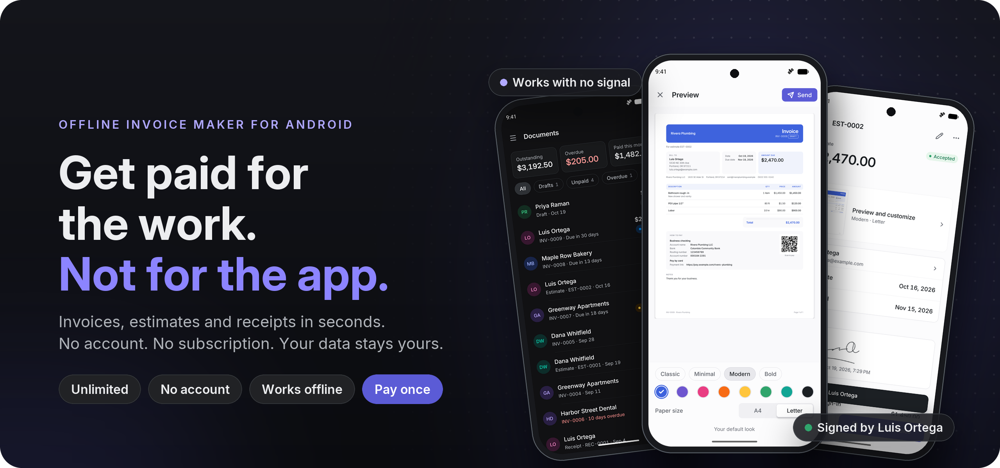
</p>

<p align="center">
  <b>An offline invoice, estimate and receipt maker for Android.</b><br>
  No account. No subscription. Your data stays on your phone.
</p>

<p align="center">
  
  
  
  
  
  
  <a href="LICENSE"></a>
</p>

<p align="center">
  <a href="#the-story">The story</a> ·
  <a href="#a-day-with-sam">A day with Sam</a> ·
  <a href="#what-it-does">What it does</a> ·
  <a href="#free-and-pro">Free and Pro</a> ·
  <a href="#under-the-hood">Under the hood</a> ·
  <a href="#run-it-yourself">Run it yourself</a> ·
  <a href="#where-it-stands">Where it stands</a>
</p>

---

## The story

**Meet Sam.** Sam is a plumber. Most days start at 7 a.m. under someone's sink and end in a van, writing invoices with cold hands.

**Every week it's the same.** Finish the job, open the invoice app, type the client's name, add the parts and the hours, send the PDF, hope it gets paid. The app is fine. Mostly.

**Until one day, the app changes.** The free plan disappears. The price Sam paid last year doubles. A pop-up says *"You've used 3 of 3 invoices this month."* Sam is in a basement with no signal, and the app wants to log in before it will open a draft.

Sam isn't alone. Before writing a line of code for this project, we read about 110 critical reviews of the most popular invoice apps on Google Play and the App Store. Roughly two in three complaints were not about features at all. They were about money and trust:

> Price hikes on people who already paid. Free plans removed overnight. Paywalls that appear only after you've typed in your data. One-time purchases quietly turned into subscriptions. Invoices lost forever when someone changed phones.

Most unlimited plans cost **$98 to $220 a year**. For someone who sends ten invoices a month, that's a lot of money for a PDF.

**So we built the app Sam actually wanted.**

- It opens straight into work. **No sign-up, no account, no login.**
- It works in a basement, on a farm, on a plane. **Everything lives on the phone.**
- You can make as many clients, items and drafts as you like. The free plan lets you send **5 documents a month**, and it says so up front.
- If you need more, you **pay once ($9.99) and keep it.** We will never turn that purchase into a subscription.
- Your data is **never held hostage.** View, edit, export and back up everything, free or Pro, forever.

**And because of that, Sam's day looks different now.** Here it is, screen by screen.

---

## A day with Sam

> Every screenshot below is the real app with a made-up business, Rivera Plumbing in Portland. Nothing on these screens needs an internet connection.

### Morning: no sign-up, just work

Sam installs the app before the first job. There's no email to confirm and no password to invent. The app asks two questions, where Sam works and what the business is called, and then it gets out of the way.

<p align="center">
  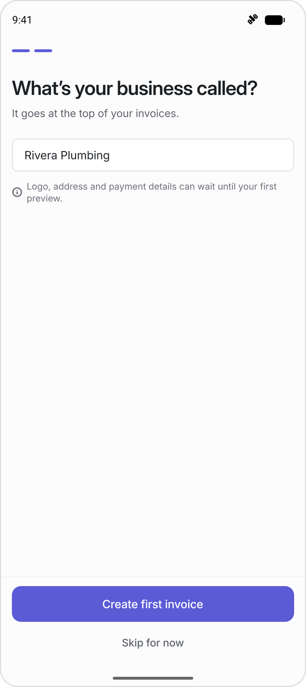
</p>

### At the job: the client signs in the kitchen

Luis wants a new shower and vanity. Sam writes the estimate on the spot ($2,470, parts and labor) and hands over the phone. Luis signs with a finger, and the estimate is accepted right there. No printer and no "I'll email it tonight".

<p align="center">
  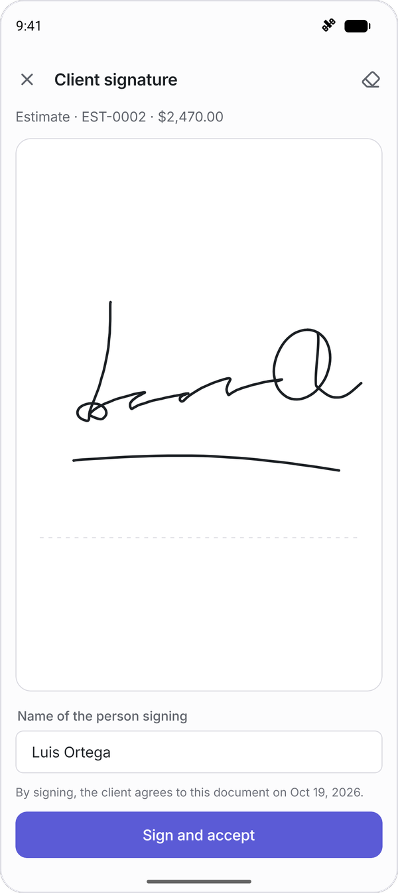
  &nbsp;&nbsp;
  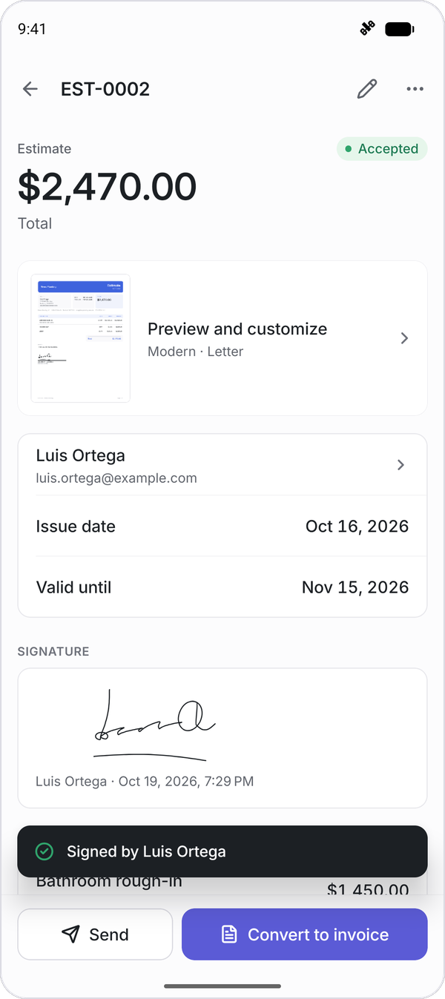
</p>

### One tap later: it's an invoice, and it looks the part

When the work is done, Sam taps **Convert to invoice**. Every line from the estimate carries over, so nothing is typed twice. The PDF looks like it came from a much bigger company: the business name up top, clear totals, bank details, and a **"Scan to pay"** QR code the client can point their camera at.

<p align="center">
  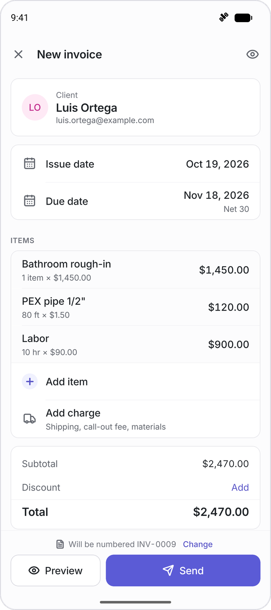
  &nbsp;&nbsp;
  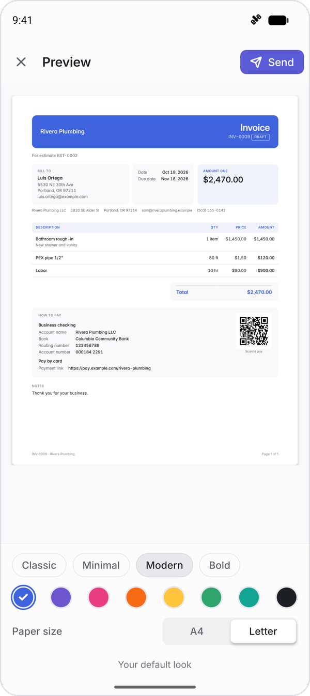
</p>

### Before leaving the driveway: sent

The message is already written ("Hi Luis, please find invoice INV-0009 for $2,470.00 attached..."). Sam picks email, WhatsApp, a text or the printer, and drives to the next job.

<p align="center">
  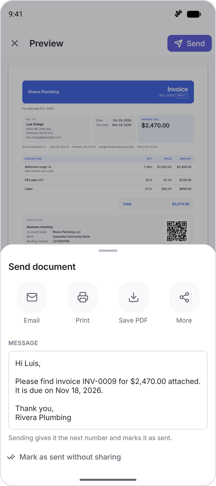
</p>

### Evening: who still owes me?

Back home, one look tells Sam what's still out, who paid half, and that Harbor Street Dental is 10 days late. The reports screen does the sums a spreadsheet used to do: income, minus fuel and parts, minus mileage, equals what Sam actually earned.

<p align="center">
  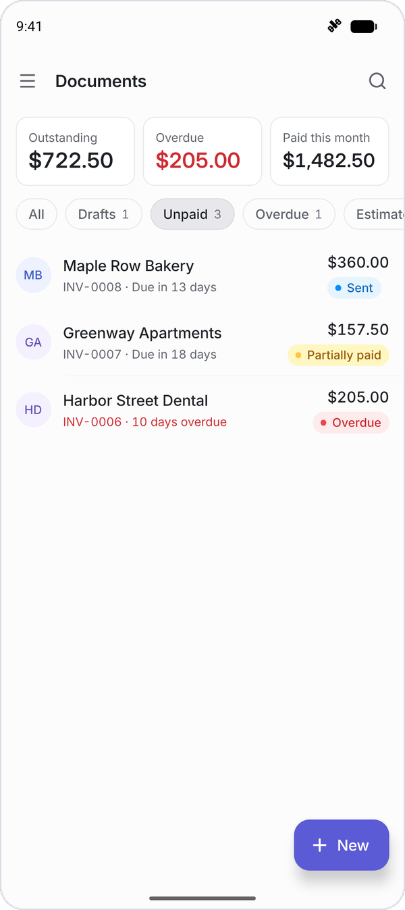
  &nbsp;&nbsp;
  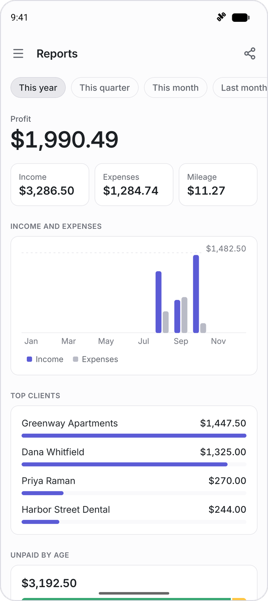
</p>

### The only time the app talks about money

The free plan covers 5 sent documents a month. If Sam wants more, or the signature and reports features above, there is one screen and one price. Read the last line: *everything you create stays yours, with or without Pro.*

<p align="center">
  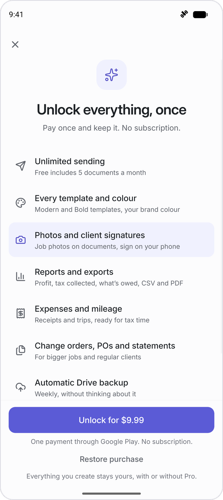
</p>

### Day or night

Light or dark, it follows the phone.

<p align="center">
  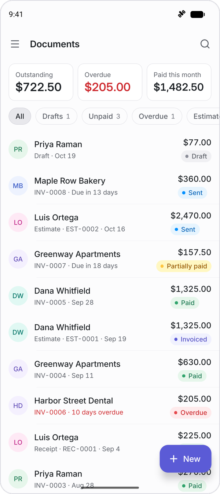
  &nbsp;&nbsp;
  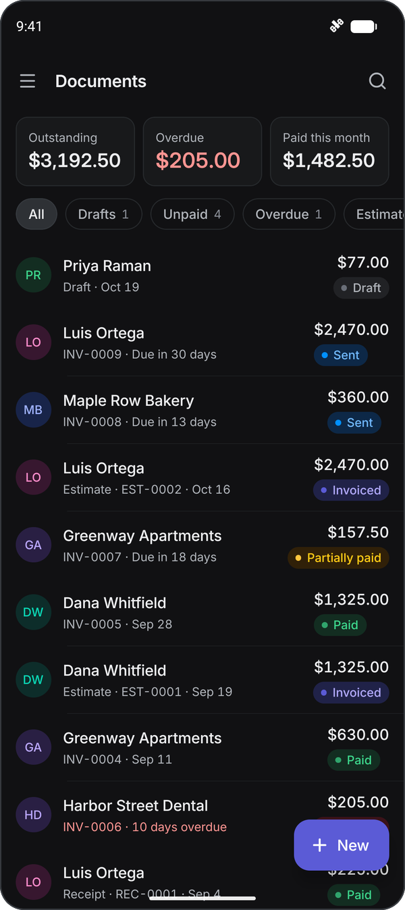
</p>

**That's the whole idea: an invoice app that gets out of the way, so you can get paid for the work.**

---

## What it does

> If you are not technical, this section is for you. No jargon, promise.

### How a job flows

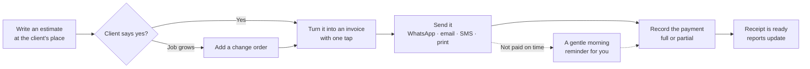

### Highlights

| | What it means for you |
|---|---|
| **Invoice in about 30 seconds** | Saved clients and items fill themselves in. A built-in calculator handles hours like "1.5 h × $90". |
| **Nine kinds of documents** | Invoice, estimate (quote), receipt, credit note, pro-forma, delivery note, change order, purchase order and statement of account. |
| **Looks professional** | Four clean PDF templates (Classic, Minimal, Modern, Bold), your logo, colour and signature, on Letter or A4 paper. See the PDF update live while you type. |
| **Gets you paid faster** | Your bank details, PayPal.me, Stripe or other payment links on every invoice, plus payment QR codes (SEPA in Europe, Pix in Brazil). |
| **Know who owes you** | An inbox like an email app: All, Drafts, Unpaid, Overdue, Estimates, Paid. Swipe to mark paid, with undo. |
| **Works with no signal** | Nothing needs the internet. Not opening the app, not writing, not making the PDF. |
| **Never lose your work** | Back up to a file or to your own Google Drive (weekly and automatic with Pro). Change phones, restore, carry on. |
| **Switch from another app** | Import clients from your phone's contacts, from a spreadsheet (CSV), or from Invoice Simple, Zoho and Bookipi exports. |
| **Repeat jobs, handled** | Recurring invoices: on the day, a ready-to-send copy appears and you send it with one tap. |
| **Money, at a glance** | Expenses with receipt photos, a mileage log, and reports for income, tax collected, unpaid invoices and profit. |
| **Private by design** | Lock the app with your fingerprint, face or screen lock. No ads. No tracking. |
| **Speaks your language** | English, Spanish, Portuguese, French and German, with tax rules ready for the US, UK, Canada, Australia, Spain, Mexico, Brazil, France, Germany and Portugal. |

### Honest limits

We'd rather tell you now than in a one-star review.

- **It doesn't process card payments.** You put your own payment link or bank details on the invoice, and your client pays you directly. No middleman holding your money.
- **There's no web version and no sync between devices.** It's a phone app, and your data lives on your phone (and in your backup).
- **In some countries it can't create official tax invoices.** Mexico (CFDI), Brazil (NF-e), Portugal (certified software) and Spain (Verifactu) require government systems. The app tells you this once, and it's still useful there for quotes, receipts and record keeping.

---

## Free and Pro

The rules are simple, and they are printed in the store listing so nobody gets surprised.

| | Free | Pro, one payment of $9.99 |
|---|:---:|:---:|
| Clients, items and drafts | Unlimited | Unlimited |
| Documents sent per month | 5 | Unlimited |
| "Made with" footer on PDFs | Small footer | None |
| Invoices, estimates, receipts, credit notes, pro-formas, delivery notes | Yes | Yes |
| Change orders, purchase orders, statements | | Yes |
| Templates | Classic, Minimal | All four, every colour and font |
| Backup | Manual (file or Drive) | Plus weekly automatic Drive backup |
| Job photos and client signatures | | Yes |
| Expenses, mileage and reports | | Yes |
| **View, edit and export your own data** | **Always** | **Always** |

Three promises behind this table:

1. **No paywall on first launch.** You only see it on your 6th send of the month, or if you tap a Pro feature.
2. **Lifetime means lifetime.** No weekly plans, no auto-renewing trials, no "lifetime" that becomes a subscription later.
3. **Your data is yours.** We never lock what you've already made.

---

## Under the hood

> From here on it's for developers. If you just wanted to know what the app does, you've got it. Thanks for reading.

The product story shaped the engineering. "Works offline, no account" means there is **no backend at all**: the database, the PDF engine and the backups all run on the phone. "Never lose your work" means money math, migrations and backups are the most heavily tested parts of the codebase.

### How the pieces fit

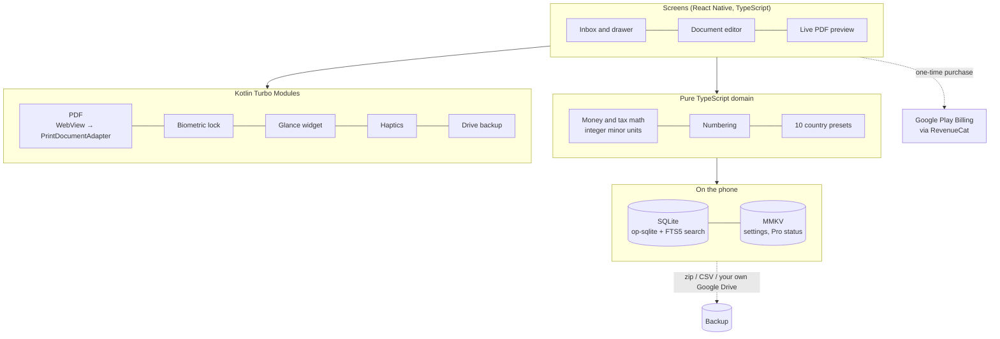

### Stack

| Area | Choice | Why |
|---|---|---|
| Framework | Bare React Native 0.87 (CLI, no Expo), New Architecture, Hermes, TypeScript strict | Full control over native code and app size |
| UI | Custom design system, Unistyles 3, Reanimated 4, Gesture Handler, bottom sheets, Inter + Inter Display, Lucide icons | Linear-style calm, fast, precise interface in light and dark |
| Data | op-sqlite with FTS5 full-text search, MMKV, Zustand | Fast local storage, instant search across thousands of documents |
| PDF | Own Kotlin PDF Turbo Module (off-screen WebView → Android print pipeline) | Selectable text, small files, print support, no third-party service |
| Billing | RevenueCat with one non-consumable `pro_lifetime` product | Works offline after purchase, restores on reinstall |
| Crash reports | Sentry, opt-out, no personal data | Find bugs without watching people |
| Languages | i18next with ICU messages (EN, ES, PT, FR, DE) | Plus a pseudo-locale that makes text 40% longer to catch layout overflow |

### Engineering decisions worth stealing

- **Money is never a float.** Amounts are integer minor units (cents, pence, centavos), quantities are integer thousandths (1.5 h is `1500`) and tax rates are integer parts per million, so Quebec's 9.975% QST is exact and `0.1 + 0.2` never ends up on someone's invoice.
- **Every country is a preset, not an `if`.** Tax rates, legal wording and numbering formats for each market live in `src/domain`, and fixture tests check the totals for every one.
- **Components read semantic tokens only.** No raw colours in screens. The whole brand accent can change in one file (`src/ui/tokens/colors.ts`), and a test makes sure every text colour passes WCAG AA contrast.
- **Release builds are tested as release builds.** R8 shrinking is on, so a missing keep rule only shows up in a real release build on a device. CI builds one on every push.

### Quality, in numbers

| Check | Result |
|---|---|
| Unit tests (Jest) | 384 passing |
| End-to-end flows (Maestro) | 7 of 7, in all 5 languages |
| Cold start to inbox (release build, emulator) | about 0.6 s (target under 1.5 s) |
| Estimated Play download | about 14 MB (arm64) |
| Text contrast | Every text colour meets WCAG AA |
| Android 15+ 16 KB page size | All 26 native libraries aligned |

---

## Run it yourself

**You need:** Node 22+, JDK 17, and the Android SDK (API 36) with NDK 27.1.

```bash
npm install
```

```bash
echo "sdk.dir=$HOME/Library/Android/sdk" > android/local.properties
```

Start Metro in one terminal:

```bash
npm start
```

Then build and install on a running emulator or a connected phone:

```bash
npm run android
```

On Android 17 (API 37), debug builds need permission to reach Metro on your computer. Grant it once after installing:

```bash
adb shell pm grant com.invoiceapp.dev android.permission.ACCESS_LOCAL_NETWORK
```

Release builds never include this permission.

### Try it without any accounts

The app runs with safe placeholders until real keys are added in [`src/config.ts`](src/config.ts). In debug builds, **Settings → Developer** gives you a Pro toggle, a component gallery, the pseudo-locale, and two kinds of sample data: a 1,000-document stress test, or **Load story data**, the small plumbing business you see in the screenshots above.

### Checks

```bash
npm run typecheck
```

```bash
npm run lint
```

```bash
npm test
```

End-to-end tests need an emulator and Metro running:

```bash
npm run e2e
```

### Release builds

Play upload bundle (`.aab`):

```bash
cd android && ./gradlew bundleRelease
```

Quick test build for a 64-bit phone:

```bash
cd android && ./gradlew assembleRelease -PreactNativeArchitectures=arm64-v8a
```

Before the first upload, set the brand name and package ID once (it can't change after that):

```bash
scripts/rename.sh com.yourbrand.invoice "Your Brand"
```

The upload key is kept out of the repo. Add these to `~/.gradle/gradle.properties`:

```properties
INVOICE_UPLOAD_STORE_FILE=/absolute/path/upload.jks
INVOICE_UPLOAD_STORE_PASSWORD=...
INVOICE_UPLOAD_KEY_ALIAS=...
INVOICE_UPLOAD_KEY_PASSWORD=...
```

### Project layout

```
src/
  app/            navigation, root providers, drawer
  features/       one folder per product area: inbox, editor, preview, clients,
                  items, expenses, mileage, reports, backup, paywall, lock, ...
  domain/         money, tax, numbering, statuses, country presets, import mapping (pure TS)
  data/           SQLite schema, migrations, repositories, search
  pdf/            the four templates, labels, QR codes, rendering
  backup/         backup snapshots and restore
  billing/        purchases, entitlement, free-plan limit
  notifications/  overdue and recurring reminders
  ui/             design system: tokens, theme, primitives, illustrations
  i18n/           en, es, pt, fr, de
  specs/          Turbo Module specs (Kotlin in android/app/src/main/java):
                  PDF, backup, Drive, lock, haptics, media, reminders, share, widget
.maestro/         end-to-end flows
docs/             product spec, build plan, status and launch documents
```

---

## Where it stands

**All eight build phases are finished**, and the app works end to end on the emulator in all five languages.

| Phase | What was built |
|---|---|
| 1 | Foundation, design system, app shell |
| 2 | Money and tax engine, SQLite data layer |
| 3 | Onboarding, inbox, editor, clients, items, command palette |
| 4 | PDF engine, four templates, live preview, sharing |
| 5 | Expenses, mileage, reports, photos, signatures |
| 6 | Backup and restore, Google Drive, import, reminders, recurring invoices |
| 7 | One-time Pro purchase, paywall, app lock, home-screen widget, tablet layouts |
| 8 | Polish, translation QA, release build, launch documents |

What's left before it reaches the Play Store is the launch paperwork: a final brand name, store and payment accounts, and a last round of checks on real phones. Details are in [docs/STATUS.md](docs/STATUS.md).

### Want to go deeper?

- [Product spec](docs/PRODUCT_SPEC.md): the market research, competitor review analysis and every "why"
- [Build plan](docs/BUILD_PLAN.md): the decisions that were locked before coding started
- [Store listing](docs/launch/store-listing.md): the Play listing copy in five languages
- [Privacy policy](docs/launch/privacy-policy.md) and [Data safety answers](docs/launch/data-safety.md)

---

## License

[MIT](LICENSE). Use it, learn from it, build on it.

---

<p align="center">
  Built for the plumbers, cleaners, tutors, designers and everyone else<br>
  who'd rather be doing the work than paying for the paperwork.
</p>
